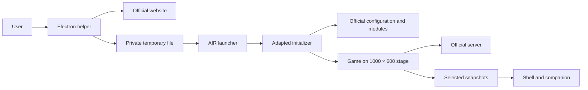

# Architecture and boundaries

[Português](../pt-BR/architecture.md) · [Índice](README.md)

## Responsibilities

`apps/login-helper` hosts official login in an isolated Electron browser. It cancels the original SWF request before execution, validates origin and parameters, and starts AIR with a temporary-file path. It does not implement an authentication service.

`apps/air-launcher` contains our ActionScript and descriptors. The launcher SWF accepts the session and loads a private adapted initializer. That initializer reads configuration and loads the game core and modules from official resources. Official servers remain responsible for authentication and match state.

In integrated mode, `LauncherShell` renders panels in the main window. An owned borderless AIR window keeps a separate 1000×600 game stage. This avoids confusing shell dimensions with dimensions assumed by the older game code. Content coordinates are converted to screen coordinates, including native macOS title-bar offsets.

## Important boundaries

The game core is neither committed nor reimplemented. The adapter changes only the bootstrap required for compatibility; its expected hash is checked during build. Updates to the official initializer may require review. Content updates referenced by configuration may download without rebuilding the adapter, but this does not guarantee compatibility with every update.

Panels do not expose arbitrary server state. They read getters on client-side models. Missing values are unavailable and hidden participants are excluded. Shoot is an explicit gameplay action, separate from data observation. See [components](components.md), [sessions](sessions.md), and [ADRs](decisions/README.md).
