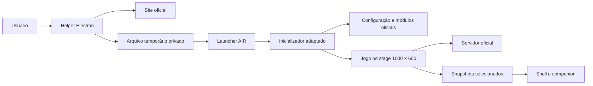

# Arquitetura e limites

[English](../en/architecture.md) · [Índice](README.md)

## Responsabilidades

`apps/login-helper` hospeda o login oficial em um navegador Electron isolado. Cancela o pedido do SWF original antes da execução, valida origem e parâmetros e inicia o AIR com um caminho de arquivo temporário. Não implementa um serviço de autenticação próprio.

`apps/air-launcher` contém nosso código ActionScript e descritores. O SWF do launcher recebe a sessão e carrega um inicializador privado adaptado. Esse inicializador consulta a configuração e carrega o núcleo e os módulos disponibilizados pelo jogo. Os servidores oficiais continuam responsáveis por autenticação e estado da partida.

No modo integrado, `LauncherShell` desenha os painéis na janela principal. Uma janela AIR anexada e sem borda mantém seu próprio stage de 1000×600 para o jogo. Isso evita confundir as dimensões do shell com as dimensões esperadas pelo código antigo. O posicionamento usa coordenadas de conteúdo convertidas para tela, incluindo a barra nativa do macOS.

## Fronteiras importantes

O código do núcleo não é incluído no Git nem reimplementado. O adaptador altera apenas o bootstrap necessário à compatibilidade; o build verifica seu hash esperado. Uma atualização do inicializador oficial pode exigir nova revisão. Atualizações de conteúdo apontadas pela configuração podem ser baixadas sem reconstruir esse adaptador, mas isso não garante compatibilidade automática com qualquer atualização.

Os painéis não têm acesso mágico a todo o servidor. Leem getters de modelos disponíveis no cliente. Campos ausentes aparecem indisponíveis e participantes ocultos não são expostos. O Shoot é uma ação explícita de gameplay, separada da leitura de dados. Consulte [componentes](components.md), [sessões](sessions.md) e os [ADRs](decisions/README.md).
