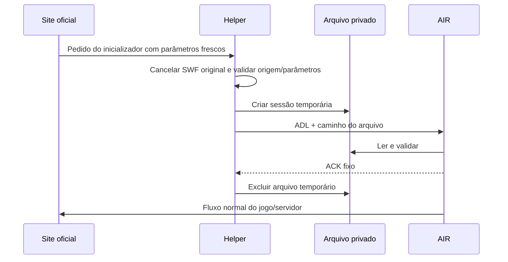

# Sessões e processos

[English](../en/sessions.md) · [Índice](README.md)

## Fluxo normal

O login pertence ao site oficial. Não copiamos cookies do navegador para o AIR. `key`, `token` e `rand` mudam entre lançamentos observados; não assumimos sua semântica ou duração do lado do servidor. A janela local de dez minutos do importador é uma defesa local, não a validade oficial de um token.

O navegador remoto não tem Node integrado; usa sandbox e isolamento de contexto. O preload observa o lançamento sem publicar uma API de sessão na página. O processo principal valida origem, janela/frame e tentativa única antes de iniciar o AIR.

## Ciclo de vida

O helper cria um arquivo exclusivo privado e inicia o ADL sem shell. Antes do ACK, falha, timeout ou saída do helper limpa o arquivo e pode encerrar o subprocesso pendente. Depois do ACK, fechar o helper não encerra deliberadamente o jogo: AIR é um processo separado. A gravação das métricas depende do helper continuar aberto.

O marcador de PID impede outra tentativa no mesmo diretório de runtime enquanto o AIR acompanhado estiver vivo. Marcadores antigos podem ser recuperados, mas um marcador inválido não é apagado indiscriminadamente. Cada cópia do projeto tem seu próprio runtime; essa proteção não é um lock global entre cópias.

Permissões privadas POSIX não equivalem a criptografia. `.local/runtime` pode conter perfil autenticado do navegador, handoffs e logs. Não compartilhe esse diretório. Feche processos antes de limpar perfis ou investigar marcadores; nunca reproduza uma sessão para diagnosticar um erro.
